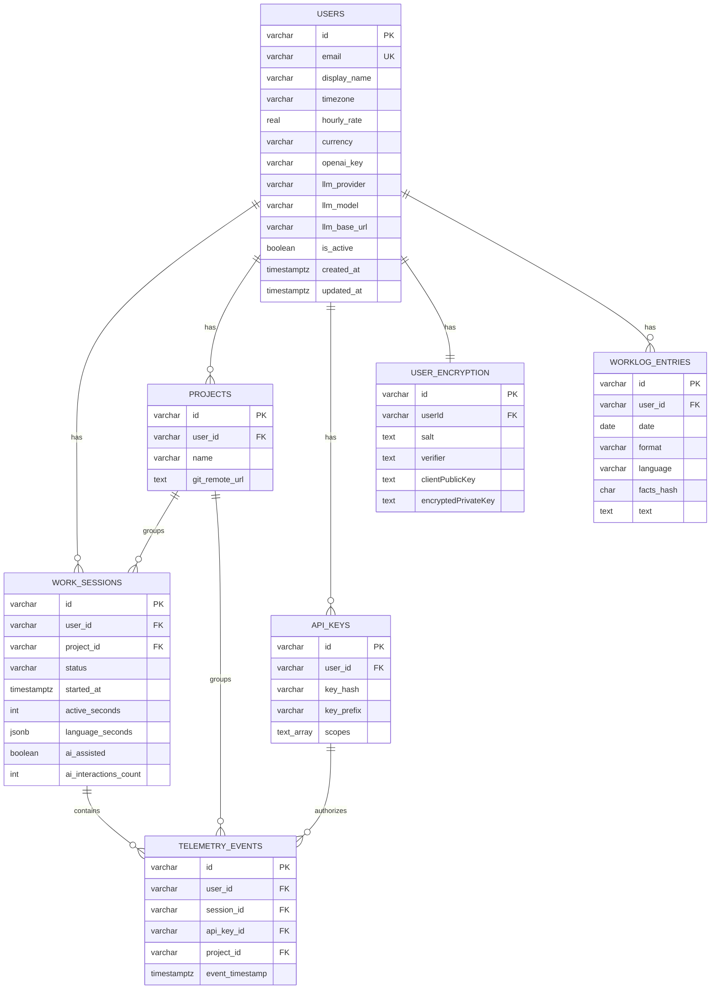

# Architecture, Shared Libraries, and Database

This document maps the monorepo, the in-house packages (`@devpulse/lib`, `@devpulse/env`), and the PostgreSQL schema as implemented in TypeORM.

---

## 1. Monorepo layout

| Path | Role |
| :--- | :--- |
| `backend/` | NestJS REST API, TypeORM, BullMQ workers |
| `packages/web/` | Next.js dashboard |
| `packages/vscode-extension/` | VS Code telemetry client |
| `packages/lib/` | `@devpulse/lib` — branded IDs, API contracts, crypto helpers |
| `packages/env/` | `@devpulse/env` — Zod-validated env for API / web / extension |
| `packages/eslint-config/` | Shared ESLint config |

Backend, web, and extension share types through `@devpulse/lib` so a `TypeId<'users'>` cannot be passed where a project ID is expected.

---

## 2. Own libraries

Teacher checklist: **interface, models, non-obvious logic, error handling, configuration / keys**.

### 2.1. `@devpulse/lib` — interface and models

**Branded IDs (`TypeId`).** Prefix map in `packages/lib/src/ids/types.ts`:

| Domain | Prefix | Example |
| :----- | :----- | :------ |
| `users` | `u` | `u_…` |
| `encryption` | `en` | `en_…` |
| `apiKeys` | `ak` | `ak_…` |
| `projects` | `p` | `p_…` |
| `telemetryEvents` | `te` | `te_…` |
| `workSessions` | `ws` | `ws_…` |
| `worklogEntries` | `we` | `we_…` |

```ts
export type TypeId<T extends IdTypePrefixes> = `${(typeof idTypes)[T]}_${string}`;
```

`typeIdGenerator('users')` builds a CUID2 payload (`TYPEID_LENGTH = 26`) with the domain prefix. `AppBaseEntity<Prefix>` uses `id: TypeId<Prefix>` as a `varchar(48)` primary key.

**Contracts (interface):**

- `ApiResponse<T>` / `ApiErrorResponse` — success envelope vs `{ success: false, error: { code, message, details? } }` (`api-response.contract.ts`). Used by `TransformInterceptor` and `AllExceptionsFilter`.
- `TelemetryEventDto` — event types the extension may send (`heartbeat`, `git_commit`, `ai_interaction`, …).
- `DashboardStats`, `IntegrationTodayStats` — analytics shapes shared with the web app.

**Non-obvious logic:**

- `stripUrlCredentials` (`git-url.ts`) strips `user:pass@` from remotes before they are stored or shown.
- Login proof (`crypto.ts`): HMAC-SHA256 over a domain-separated message (`DevPulse-v1-login-proof`) using `@noble/hashes` + `tweetnacl` challenges. Not a full Diffie–Hellman; the challenge is a nonce.

**Error handling in the library:** the package defines the **error JSON shape**. HTTP mapping lives in the backend filter (see `docs/maintenance.md`).

### 2.2. `@devpulse/env` — configuration and keys

Zod + `@t3-oss/env-core`. Backend (`packages/env/api.ts`) fails boot if required keys are missing:

| Variable | Purpose |
| :------- | :------ |
| `DATABASE_URL`, `POSTGRES_*` | PostgreSQL |
| `REDIS_URL` | Redis / BullMQ |
| `JWT_SECRET`, `JWT_EXPIRES_IN` | Access tokens |
| `CORS_ORIGIN` | Allowed web origin |
| `RESEND_API_KEY`, `EMAIL_FROM` | Transactional email |

LLM keys are **not** in server env: each user stores their OpenRouter / OpenAI / custom key on the `users` row (profile Settings).

---

## 3. Database environment

| | |
| :-- | :-- |
| **Engine** | PostgreSQL 16 (`postgres:16-alpine` in `docker-compose.yml`) |
| **ORM** | TypeORM on NestJS |
| **Dev schema** | `synchronize: true` when `NODE_ENV !== 'production'` |
| **Prod schema** | `migrationsRun: true`; migrations under `backend/src/db/migrations/` |
| **Cache / queue** | Redis 7 (not a second database of record) |

Every table extends `AppBaseEntity`: branded `id`, `created_at`, `updated_at` (`timestamptz`).

---

## 4. Tables and ERD



---

## 5. Models (what each table is for)

### `users`

Account, timezone (daily analytics), hourly rate / currency (earnings), LLM provider fields (`llm_provider`, `llm_model`, `llm_base_url`, `openai_key`). Email is unique.

### `user_encryption` (1:1)

SRP salt/verifier and wrapped keys. Separate table so profile queries do not load crypto material.

### `api_keys`

`key_hash` is unique and `select: false` (never loaded by default). `scopes` is a PostgreSQL `text[]` (`telemetry:write` / `analytics:read`).

### `projects`

Git remotes per user. Unique constraint on `[gitRemoteUrl, userId]`.

### `work_sessions`

Aggregated work blocks: focus, languages (`JSONB`), terminal commands (`JSONB`), commits (`JSONB`), AI flags (`ai_assisted`, `ai_interactions_count`). Status enum: `active` | `closed`.

### `telemetry_events`

Raw extension events for audit and re-aggregation.

### `worklog_entries`

Cached AI worklog text. Unique on `[userId, date, format, language]`. `facts_hash` invalidates the cache when session facts change.

---

## 6. Relations and FK actions

| Relation | Cardinality | `onDelete` |
| :------- | :---------- | :--------- |
| User → Project | 1:N | `CASCADE` |
| User → ApiKey | 1:N | `CASCADE` |
| User → WorkSession | 1:N | `CASCADE` |
| User → UserEncryption | 1:1 | `CASCADE` |
| User → WorklogEntry | 1:N | `CASCADE` |
| Project → WorkSession | 1:N | `SET NULL` |
| WorkSession → TelemetryEvent | 1:N | `CASCADE` |
| ApiKey → TelemetryEvent | 1:N | `SET NULL` |
| Project → TelemetryEvent | 1:N | `SET NULL` |

Deleting a user removes projects, keys, sessions, events, encryption, and worklogs. Deleting a project keeps sessions with `project_id = NULL`.

---

## 7. Indexes

Declared with TypeORM `@Index`:

| Table | Index |
| :---- | :---- |
| `work_sessions` | `[userId, startedAt]`, `[userId, gitBranch, status]`, `[projectId, gitBranch]` |
| `telemetry_events` | `[userId, eventTimestamp]`, `[projectId, gitBranch, eventTimestamp]` |

These match dashboard filters (user + time range, branch, project).

---

## 8. Procedures, functions, triggers

**None in PostgreSQL.** Aggregation (`focus_score`, session grouping) runs in `TelemetryWorker` (NestJS + BullMQ). Easier to test and version than PL/pgSQL.

Integrity comes from:

- Foreign keys (`CASCADE` / `SET NULL`)
- Unique constraints (`users.email`, `projects(gitRemoteUrl, userId)`, `worklog_entries(userId, date, format, language)`, `api_keys.key_hash`)
- Application validation (`class-validator` + global `ValidationPipe`) before insert

---

## 9. Scaling and sharding

Current shape: **one PostgreSQL primary**, **stateless API**, **Redis** for BullMQ (`telemetry-ingestion` queue, 3 attempts, exponential backoff) and auth/rate-limit support.

| Technique | Status |
| :-------- | :----- |
| Vertical scale | Increase CPU/RAM on the API and Postgres host |
| Horizontal scale | Run more NestJS processes behind a load balancer (JWT in cookie/header, no sticky sessions required) |
| Queue offload | Telemetry ingest is async; the HTTP handler only enqueues |
| Read replicas | Not deployed; analytics are user-scoped `SELECT`s on indexed columns — replicas are the next step |
| Sharding | **Not used.** All rows are already keyed by `user_id` (`TypeId<'users'>`), so a later hash-shard by user is possible without rewriting IDs. JSONB avoids extra tables for command/commit lists |

Redis is **not** sharded; one instance is enough for the queue size of a single-team deployment.
