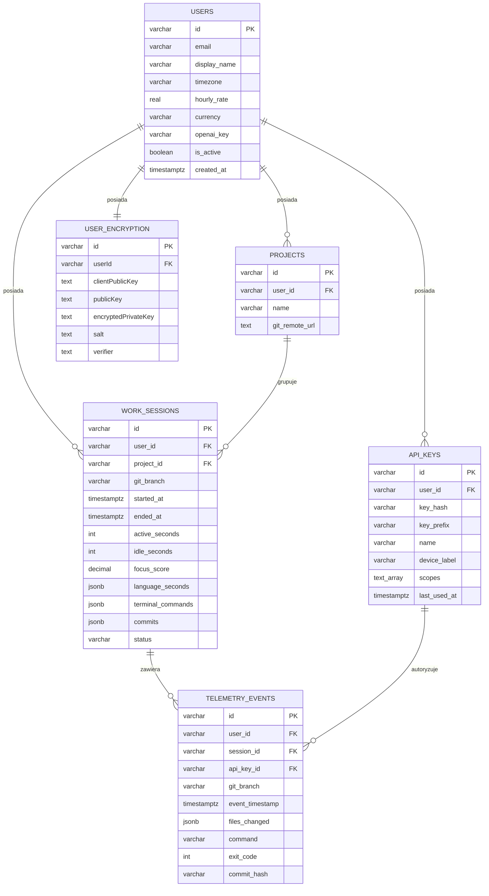

# Architektura Bazy Danych (DevPulse)

## 1. Środowisko bazodanowe

System wykorzystuje relacyjną bazę danych **PostgreSQL w wersji 16**.
Komunikacja z bazą odbywa się za pomocą ORM **TypeORM** (w ekosystemie NestJS). Baza danych jest uruchamiana w kontenerze Docker (zdefiniowanym w `docker-compose.yml`), co zapewnia spójność środowiska deweloperskiego i produkcyjnego.

Wszystkie tabele dziedziczą po klasie bazowej `AppBaseEntity`, która automatycznie zarządza kluczem głównym `id` (typowany prefiksowo, np. `ws_...`, `u_...`) oraz polami audytowymi `created_at` i `updated_at`.

## 2. Tabele i struktura bazy danych (ERD)

## 3. Opis modeli i tabel

### `users` (Użytkownicy)

Przechowuje podstawowe informacje o koncie, w tym strefę czasową (kluczową dla poprawnego wyliczania sesji dziennych) oraz stawkę godzinową (do kalkulacji zarobków).

### `user_encryption` (Szyfrowanie użytkownika)

Wydzielona tabela 1:1 przechowująca klucze kryptograficzne (m.in. `clientPublicKey`, `encryptedPrivateKey`, `salt`). Zapobiega to niepotrzebnemu ładowaniu wrażliwych danych przy każdym zapytaniu o profil użytkownika.

### `api_keys` (Klucze API)

Przechowuje hash kluczy API (klucze nigdy nie są zapisywane w postaci jawnej, pole `key_hash` ma atrybut `select: false`). Pole `scopes` (PostgreSQL Text Array) definiuje uprawnienia (np. `telemetry:write`, `analytics:read`). Zawiera również metadane, takie jak nazwa urządzenia i data ostatniego użycia.

### `projects` (Projekty)

Reprezentuje repozytoria Git powiązane z użytkownikiem. Projekty są identyfikowane po unikalnym adresie `git_remote_url` (dla danego użytkownika). Tabela posiada ograniczenie unikalności (Unique Constraint) na parze `[gitRemoteUrl, userId]`.

### `work_sessions` (Sesje pracy)

Główna tabela analityczna. Agreguje surowe zdarzenia w logiczne bloki pracy.

- Zawiera metryki: `active_seconds`, `idle_seconds`, `focus_score`, `earned_money`.
- Wykorzystuje pola JSONB (`language_seconds`, `terminal_commands`, `commits`) do elastycznego przechowywania danych bez konieczności tworzenia dziesiątek dodatkowych tabel. To optymalizacja pod kątem wydajności odczytu na dashboardzie.
- Status sesji (`active`/`closed`) jest kontrolowany przez enum.

### `telemetry_events` (Zdarzenia telemetryczne)

Surowe dane wysyłane z rozszerzenia VS Code. Służą do audytu oraz ewentualnego przeliczania sesji (np. przy zmianie algorytmu). Zawierają szczegóły takie jak zmienione pliki (`files_changed`), uruchomione komendy (`command`, `exit_code`), czy hashe commitów (`commit_hash`).

## 4. Powiązania pomiędzy modelami

- **User -> WorkSession** (1:N): Jeden użytkownik ma wiele sesji pracy.
- **User -> Project** (1:N): Jeden użytkownik ma wiele projektów.
- **User -> ApiKey** (1:N): Jeden użytkownik ma wiele kluczy API.
- **User -> UserEncryption** (1:1): Jeden użytkownik ma jeden zestaw kluczy kryptograficznych.
- **Project -> WorkSession** (1:N): Jedna sesja pracy jest przypisana do jednego projektu.
- **WorkSession -> TelemetryEvent** (1:N): Jedna sesja zawiera wiele zdarzeń telemetrycznych.
- **ApiKey -> TelemetryEvent** (1:N): Zdarzenia mogą być powiązane z kluczem API, który je autoryzował.

## 5. Indeksy (Wydajność)

Baza wykorzystuje indeksy złożone zdefiniowane w encjach TypeORM (adnotacje `@Index`), aby zoptymalizować najczęstsze zapytania analityczne:

- `work_sessions`: `[userId, startedAt]`, `[userId, gitBranch, status]`, `[projectId, gitBranch]`.
- `telemetry_events`: `[userId, eventTimestamp]`, `[projectId, gitBranch, eventTimestamp]`.

## 6. Procedury i wyzwalacze (Triggers)

Zgodnie z dobrymi praktykami architektury mikroserwisowej, **logika biznesowa nie jest przenoszona do bazy danych**.
Zamiast procedur składowanych (PL/pgSQL), cała logika agregacji (np. przeliczanie `focus_score` czy grupowanie zdarzeń w sesje) odbywa się w warstwie aplikacji (w `TelemetryWorker` w NestJS). Ułatwia to testowanie, wersjonowanie i utrzymanie kodu.

Baza danych nie wykorzystuje wyzwalaczy (triggerów). Integralność danych jest zapewniana przez:

- Klucze obce (Foreign Keys) zdefiniowane w encjach TypeORM (np. `ON DELETE CASCADE` dla usuwania kont użytkowników, `SET NULL` dla projektów).
- Walidację na poziomie aplikacji (za pomocą biblioteki `class-validator` przed zapisem do bazy).

## 7. Architektura środowiska i skalowanie

- **Enkapsulacja informacji:** Dane wrażliwe (klucze kryptograficzne) są odseparowane w tabeli `user_encryption`, a hashe kluczy API w `api_keys` mają domyślnie wyłączony odczyt (`select: false`).
- **Elastyczność (JSONB):** Użycie typu `JSONB` w `work_sessions` i `telemetry_events` pozwala na przechowywanie dynamicznych struktur (list komend, commitów) bez konieczności ciągłego modyfikowania schematu bazy (migracji).
- **Skalowanie:** Aplikacja jest bezstanowa. W przyszłości możliwe jest zastosowanie replikacji PostgreSQL (Read Replicas) w celu odciążenia zapytań analitycznych (SELECT) od operacji zapisu (INSERT/UPDATE).
